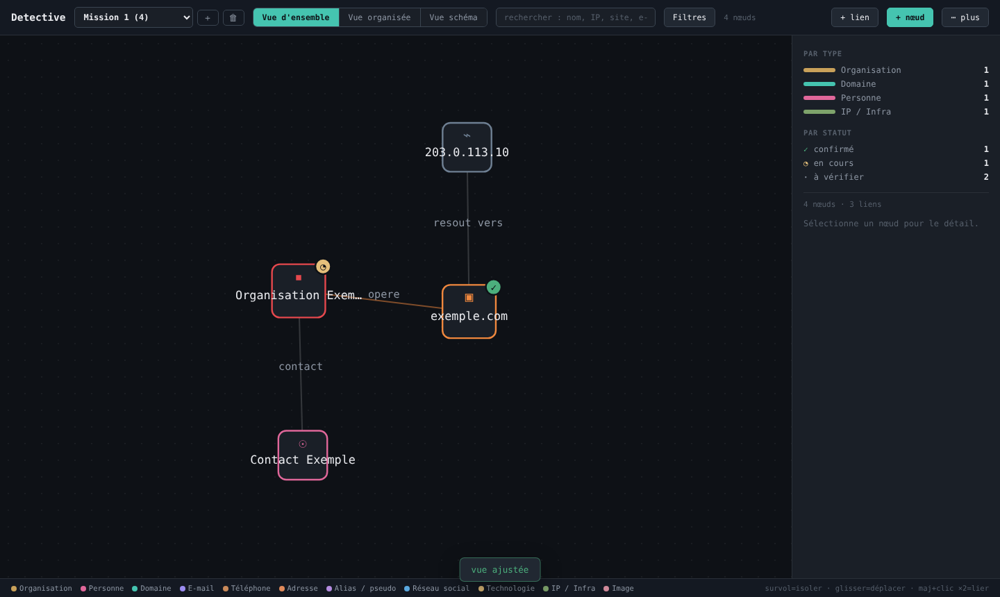

# Detective

Detective est une plateforme d'investigation OSINT qui organise et relie en graphe les cibles, entités et éléments collectés pendant une mission. Elle est pensée pour la reconnaissance passive (Red Team, bug bounty, veille), en fichier unique et sans dépendance externe.



## Objectifs

- Centraliser les éléments collectés pendant une investigation OSINT (domaines, sous-domaines, IP, personnes, organisations, comptes sociaux, documents, images...) plutôt que de les disperser dans des notes.
- Visualiser les relations entre ces éléments sous forme de graphe interactif, pour faire émerger des pivots qu'une liste à plat ne montre pas.
- Garder une trace structurée : importance, niveau de confiance et statut d'investigation pour chaque élément.
- Gérer plusieurs missions/cibles indépendantes dans un seul outil.

## Fonctionnalités

- **Trois vues** sur les mêmes données : vue d'ensemble (graphe physique avec liens), vue organisée (nœuds groupés par type, pour l'inventaire), vue schéma (disposition en couches depuis le nœud le plus connecté).
- **Nœuds typés** : organisation, personne, domaine, sous-domaine, e-mail, téléphone, adresse, alias, réseau social, technologie, service, IP/infra, image, document, lacune, exclu, autre.
- **Qualification de chaque élément** : importance (critique → exclu), statut d'investigation (à vérifier, en cours, confirmé, vulnérabilité, rien découvert, écarté), niveau de confiance.
- **Pièces jointes** : image (aperçu intégré au nœud) et document (PDF, Office, texte...) téléversés avec validation réelle du contenu, noms de fichiers aléatoires, extensions exécutables bloquées.
- **Multi-missions** : chaque cible/enquête est un projet isolé ; les liens entre projets sont impossibles.
- **Recherche et filtres** combinés (type, importance, statut) avec mise en évidence sur le graphe.
- **Import / export JSON** de la cartographie complète, pour archiver ou ré-ouvrir une mission.
- **Responsive mobile-first** : utilisable sur ordinateur, tablette et téléphone, avec support tactile complet sur le graphe (glisser, pincer-zoomer).

## Technologies

- **Backend** : PHP 8+ (aucun framework, aucune dépendance Composer), PDO avec requêtes préparées.
- **Base de données** : MySQL / MariaDB.
- **Frontend** : HTML, CSS et JavaScript vanilla (aucune bibliothèque), rendu en SVG.
- **Architecture** : un seul fichier applicatif (`index.php`) qui sert à la fois l'API JSON et l'interface. Un choix volontaire, pour rester simple à auditer, déployer et faire évoluer.

## Prérequis

- PHP 8.0 ou supérieur, avec l'extension `pdo_mysql`.
- Un serveur MySQL ou MariaDB.
- Un serveur web (Apache recommandé, pour que le `.htaccess` du dossier `uploads/` soit pris en compte : voir *Sécurité* ci-dessous). Un empaquetage type XAMPP/WAMP/MAMP convient.

## Installation

1. **Cloner le dépôt** dans le dossier servi par votre serveur web (ex. `htdocs/` sous XAMPP).

   ```bash
   git clone https://github.com/Dan-Thembela/detective.git
   cd detective
   ```

2. **Importer le schéma** (une seule fois) :

   ```bash
   mysql -u root -p < schema.sql
   ```

   Ceci crée la base `detective`, ses trois tables (`projects`, `nodes`, `links`) et une mission de démarrage vide ("Mission 1").

3. **Créer un compte MySQL dédié** (évitez `root`) :

   ```sql
   CREATE USER 'detective_app'@'localhost' IDENTIFIED BY 'un-mot-de-passe-solide';
   GRANT SELECT,INSERT,UPDATE,DELETE ON detective.* TO 'detective_app'@'localhost';
   ```

## Configuration

Copiez le fichier d'exemple et renseignez vos identifiants :

```bash
cp config.sample.php config.php
```

```php
return [
  'db_host' => '127.0.0.1',
  'db_name' => 'detective',
  'db_user' => 'detective_app',
  'db_pass' => 'un-mot-de-passe-solide',
];
```

`config.php` n'est **jamais** versionné (voir `.gitignore`). Il contient des secrets.

Alternative sans fichier (déploiement conteneurisé, CI...) : définissez les variables d'environnement `DETECTIVE_DB_HOST`, `DETECTIVE_DB_NAME`, `DETECTIVE_DB_USER`, `DETECTIVE_DB_PASS`. Elles sont utilisées automatiquement si `config.php` est absent.

## Lancement

Avec XAMPP/WAMP/MAMP, placez le dossier dans `htdocs/` puis ouvrez `http://localhost/detective/`.

Pour un test rapide sans serveur web dédié, le serveur intégré de PHP suffit :

```bash
php -S localhost:8000
```

puis ouvrez `http://localhost:8000/`.

## Utilisation

- **+ nœud** / **+ lien** pour ajouter un élément ou une relation. Depuis la fiche d'un nœud, **+ ajouter un élément lié** crée directement un nœud connecté.
- **Glisser** un nœud pour le repositionner (la position est mémorisée) ; **glisser le vide** pour déplacer la vue ; **molette / pincer** pour zoomer.
- **Maj + clic** sur deux nœuds successifs pour créer un lien rapidement.
- **Survol** d'un nœud pour isoler visuellement ses connexions directes.
- Le menu **⋯ plus** regroupe l'import, l'export, l'ajustement de la vue et le relance du placement automatique.
- Le sélecteur de mission (en haut à gauche) permet de créer et basculer entre plusieurs investigations indépendantes.

## Sécurité

- Toutes les requêtes SQL passent par des requêtes préparées PDO (`PDO::ATTR_EMULATE_PREPARES` désactivé).
- Les fichiers téléversés sont validés par leur contenu réel (pas seulement l'extension), renommés aléatoirement, et le dossier `uploads/` reçoit un `.htaccess` qui désactive l'exécution PHP. Cette protection suppose un serveur **Apache** avec `AllowOverride` autorisant les `.htaccess`. Sur un autre serveur (nginx, etc.), ajoutez l'équivalent dans la configuration du site pour empêcher l'exécution de scripts dans `uploads/`.
- Aucun identifiant n'est présent dans le code source : voir *Configuration*.
- Les sorties affichées dans l'interface sont échappées côté client pour prévenir les injections HTML/JS.

## Usage responsable

Detective est un outil d'organisation et de visualisation pour de la reconnaissance **passive**. Il n'intègre aucune fonction de scan actif ni d'exploitation. Il est destiné à des missions autorisées (tests d'intrusion sous mandat, bug bounty dans le périmètre défini, veille sur son propre périmètre) et à un usage pédagogique. Utilisez-le dans un cadre légal, avec l'autorisation explicite du périmètre concerné, et dans le respect de la vie privée des personnes dont des informations seraient collectées. Les données saisies dans l'outil restent dans votre propre base de données. Ne publiez jamais une exportation contenant des informations réelles sur une cible ou des tiers.

## Licence

MIT. Voir [LICENSE](LICENSE). Libre réutilisation, modification et usage commercial, y compris en code fermé.
